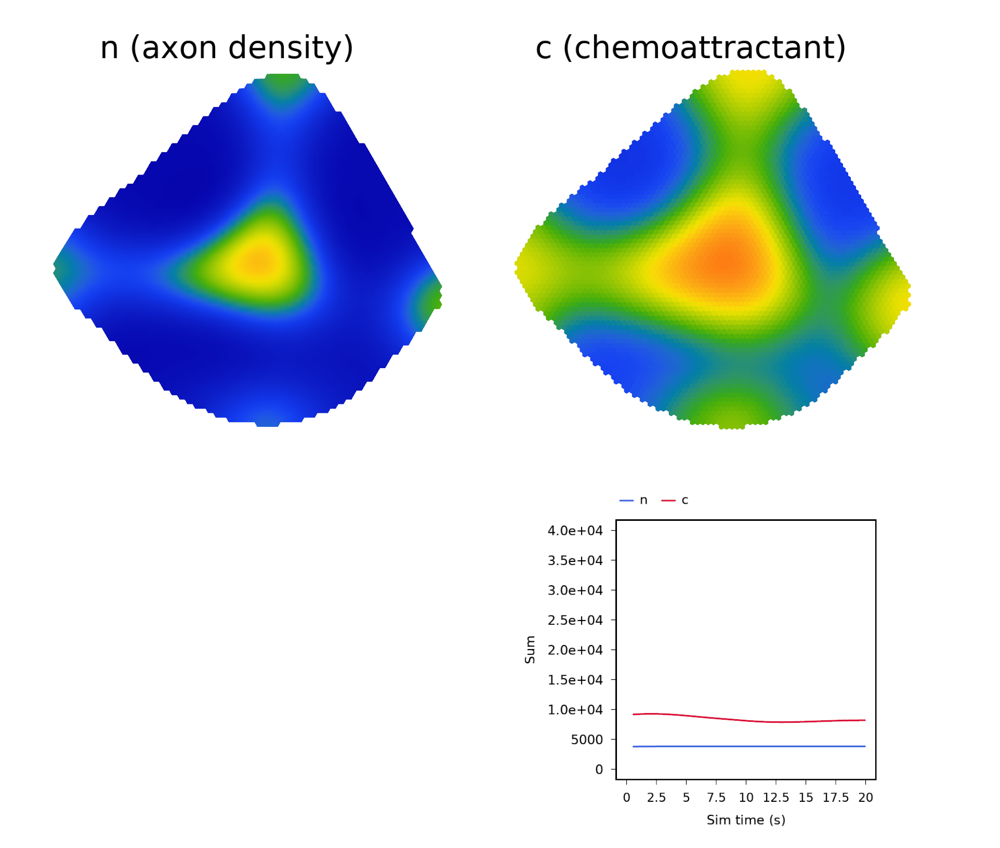

# Ermentrout 2009 reaction diffusion system

The Keller-Segal equations applied to whisker barrel cortex.

This implements the system described in *Subbarrel Patterns in Somatosensory Cortical Barrels Can Emerge from Local Dynamic Instabilities* by Ermentrout, Simons and Land:

https://journals.plos.org/ploscompbiol/article?id=10.1371/journal.pcbi.1000537




## Dependencies

This program uses C++ modules. At the time of writing, this means that
you have to compile with the clang compiler (version 20 or above).

If you are using Debian or Ubuntu, the following `apt` command should
install the mathplot dependencies.

```bash
sudo apt install build-essential cmake git ninja-build  \
                 freeglut3-dev libglu1-mesa-dev libxmu-dev libxi-dev \
                 libglfw3-dev libfreetype-dev clang-20 clang-tools-20 \
                 librapidxml-dev libhdf5-dev
```

If you're building on a Mac, you can refer to mathplot's [Mac
README](https://github.com/sebsjames/mathplot/blob/main/README.build.mac.md#installation-dependencies-for-mac)
for help. You only need to obtain and build
[glfw3](https://github.com/sebsjames/mathplot/blob/main/README.build.mac.md#glfw3);
OpenGL and Freetype should already be installed by default.

## Building

To build and run the example:

```bash
# Clone this example
git clone git@github.com:sebsjames/ermentrout2009

# Bring in the submodules - sebsjames/mathplot, sebsjames/maths , sebsjames/maths_config and nlohmann/json
cd ermentrout2009
git submodule init
git submodule update

# Build it in a 'build' directory
mkdir build
cd build
CC=clang-20 CXX=clang++-20 cmake .. -GNinja
ninja
cd ..

# Run an example
./build/erm configs/erm.json

# Reproduce the examples shown in the paper figures
./build/erm configs/erm_2009_fig5Ai.json
./build/erm configs/erm_2009_fig5Aii.json
./build/erm configs/erm_2009_fig5Aiii.json
./build/erm configs/erm_2009_fig5Aiv.json
```
